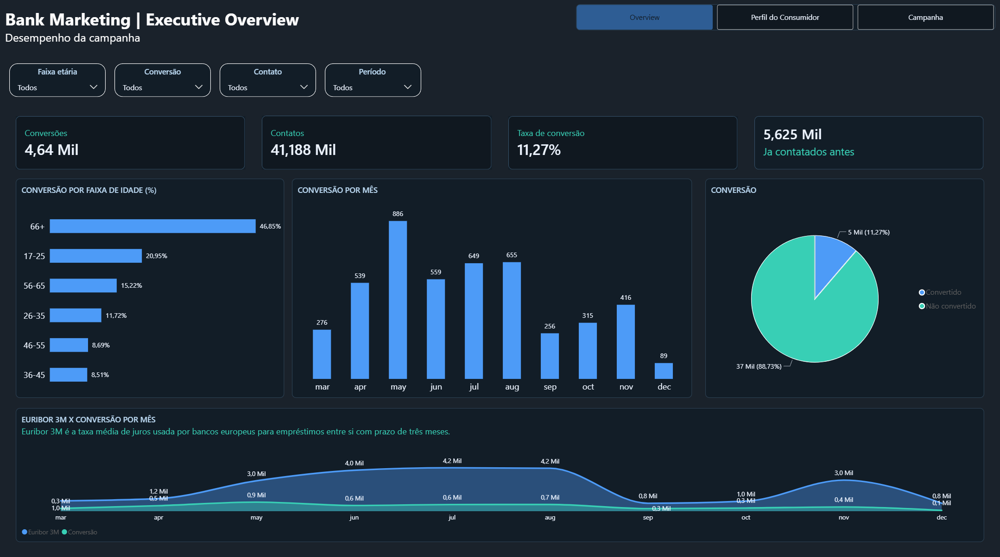
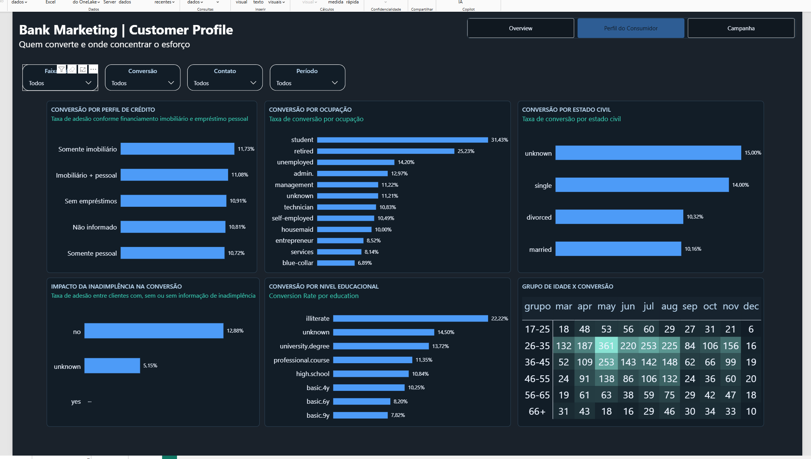
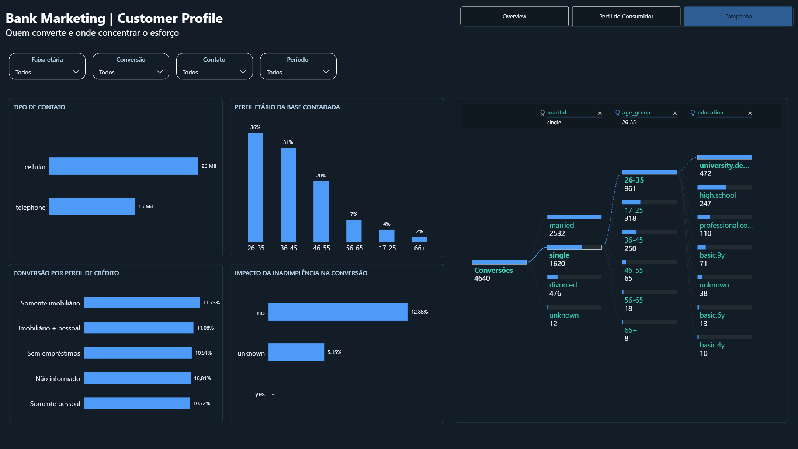

# Bank Marketing | Do Azure SQL ao Power BI

Projeto de portfólio em análise de dados, de ponta a ponta: banco de dados na nuvem, tratamento em SQL e dashboard no Power BI.

**Pergunta de negócio:** quem converte em campanhas de telemarketing bancário e onde vale concentrar o esforço comercial?

> Os dados são do dataset público *Bank Marketing*, do UCI Machine Learning Repository (Moro, Rita & Cortez, 2014), licença **CC BY 4.0**. Veja [Fonte dos dados](#fonte-dos-dados).



## O que foi entregue

- Banco no **Azure SQL Database** (oferta gratuita), com 41.188 registros importados.
- **View em T-SQL** com o tratamento dos dados. A tabela bruta não é alterada.
- **Dashboard no Power BI** com 3 abas (Overview, Perfil do Consumidor e Campanha) e um tooltip interativo, em formato 16:9 para exibição em TV.
- **Documentação:** premissas, dicionário de dados, medidas DAX, análise e guia para reproduzir.

## Como o trabalho foi feito

1. Importei o CSV para o Azure com o assistente do VS Code, revisando coluna por coluna.
2. Validei a carga: 41.188 linhas, 4.640 conversões e 11,27% de taxa.
3. Medi a qualidade dos dados (valores `unknown`, código `pdays = 999`, limites numéricos).
4. Registrei cada decisão de tratamento em uma view SQL.
5. Conectei o Power BI à view em modo Import e criei as medidas em DAX.
6. Montei o dashboard em 3 abas.

## O que os dados mostram

- A taxa geral de conversão é 11,27% (4.640 de 41.188 contatos).
- Os mais jovens e os mais velhos convertem mais. A faixa de 36 a 55 anos converte menos e recebeu cerca de metade dos contatos.
- Estudantes e aposentados lideram a conversão por ocupação.
- Os meses com muitas ligações converteram menos.

Os dados mostram associação, não causa. Veja [`docs/analise.md`](docs/analise.md).

## Telas do dashboard

| Perfil do Consumidor | Campanha |
|---|---|
|  |  |

## Estrutura do repositório

```
data/        como obter o CSV (o arquivo não é versionado)
docs/        premissas, dicionário, análise, etapas, guia e imagens
sql/         importação, profiling, view e validação (ordem numerada)
powerbi/     relatório .pbix, tema JSON e medidas DAX
```

## Como reproduzir

Siga o guia [`docs/como-reproduzir.md`](docs/como-reproduzir.md). Em resumo:

1. Baixe o CSV (veja `data/README.md`).
2. Crie o banco no Azure e libere o acesso à rede.
3. Importe o CSV pelo VS Code.
4. Rode os scripts de `sql/` na ordem 01, 02, 03 e 04.
5. Abra o `.pbix` e aponte a conexão para o seu servidor.

## Ferramentas

Azure SQL Database, Visual Studio Code (extensão SQL Server), T-SQL, Power BI Desktop e DAX.

## Limites e pendências

- Sem coluna de ano nos dados: a análise é por mês.
- A faixa 66+ tem só 619 contatos.
- O dashboard ainda tem pendências visuais registradas em [`docs/premissas.md`](docs/premissas.md).
- A publicação no Power BI Service com atualização agendada não foi feita.

## Documentos

- [Premissas e decisões de tratamento](docs/premissas.md)
- [Dicionário de dados](docs/dicionario-dados.md)
- [Medidas DAX](powerbi/medidas-dax.md)
- [Análise em linguagem simples](docs/analise.md)
- [Etapas do projeto](docs/etapas-do-projeto.md)
- [Documento completo do processo (Word)](docs/processo-completo.docx)

## Fonte dos dados

Moro, S., Rita, P., & Cortez, P. (2014). *Bank Marketing* [Dataset]. UCI Machine Learning Repository. https://doi.org/10.24432/C5K306
Licença: [CC BY 4.0](https://creativecommons.org/licenses/by/4.0/).

## Autor

Guilherme DM
<!https://www.linkedin.com/in/guilhermemartins0/>
